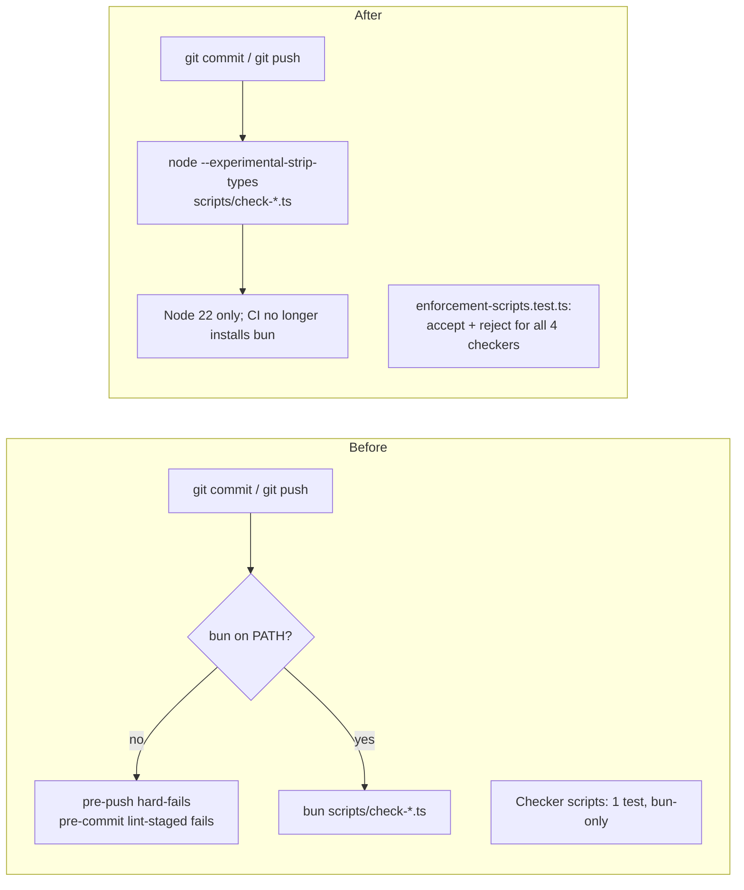

# PR 22 review feedback: before -> after

| Review item | Change |
|---|---|
| 1. bun hard-fail | Checkers run on Node 22 (type stripping); bun dropped from package.json, lint-staged, pre-push, CI, CLAUDE.md. pre-push now only warns+skips if pnpm is missing. |
| 2. Checker tests | New `frontend/app/lib/enforcement-scripts.test.ts` (accept/reject for coverage, page, sweep, emoji); existing sweep test moved off bun and gains a ds-ignore case. |
| Merge | origin/main merged in; 4 conflicts resolved; 9 raw `<button>` added on main converted to `<Button>`; stale `@/components/Button` imports repointed to `ui/button`. |
